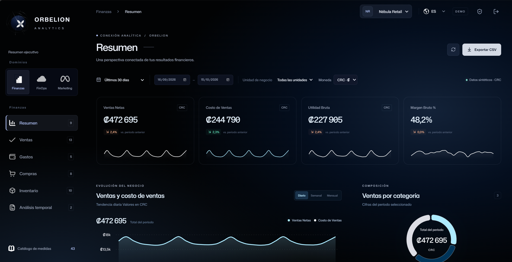
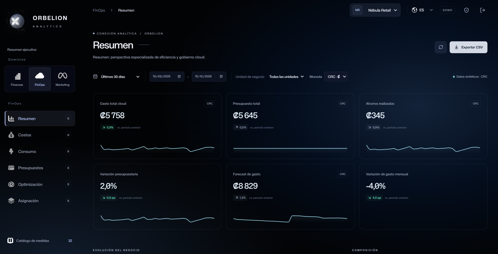
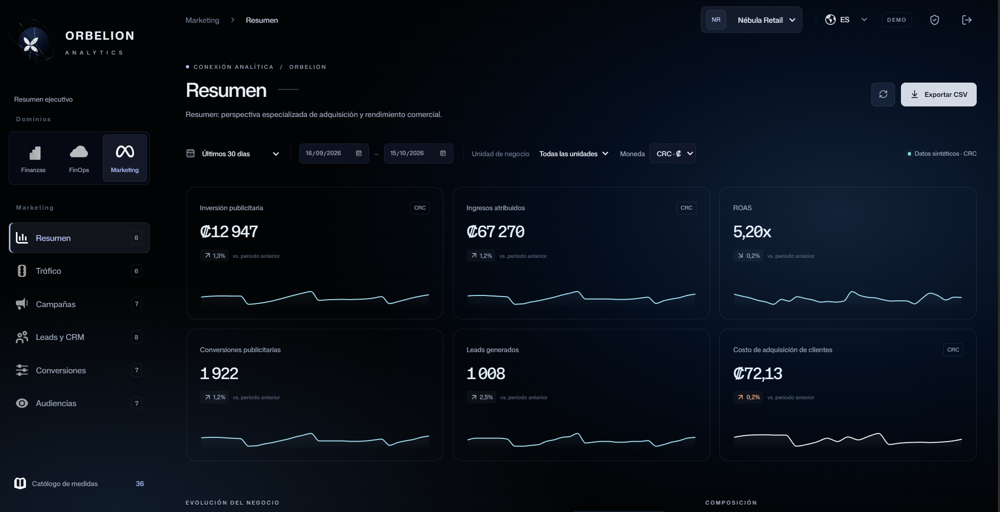
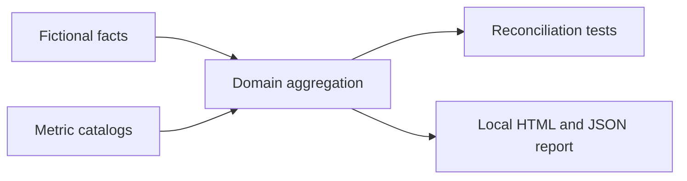

# ORBELION Analytics Dashboard

**Modular business analytics, presented as a curated engineering case study.**

Finance, FinOps and Marketing share a consistent analytical experience while retaining separate facts, metric definitions and aggregation rules. This repository demonstrates the synthetic analytical core; the operational application and its history remain private.

| Domain | Public evidence | Analytical focus |
| --- | --- | --- |
| Finance | 43 metric definitions, 6 page definitions | Sales, cost of goods, profit, weighted margins and inventory |
| FinOps | 32 metric definitions, 6 page definitions | Cloud cost allocation, budgets, resource telemetry and savings |
| Marketing | 36 metric definitions, 6 page definitions | Acquisition cost, attribution, traffic and CRM cohorts |

**111 metric definitions | 18 page definitions | deterministic fixtures | zero external dependencies**

## Dashboard evidence

Original screenshots supplied for the portfolio. All three show the fictional Nebula Retail scenario in DEMO mode with synthetic CRC values. They document the product interface; the executable public sample remains the separate local report below.

### Finance

Net sales, cost of sales, gross profit and margin, with business-unit/date filters and category composition.



### FinOps

Cloud spend, budget, realized savings, budget variance and a synthetic spend forecast.



### Marketing

Advertising investment, attributed revenue, ROAS, conversions, leads and acquisition cost.



## Architecture workflow

The supplied ETL architecture places ORBELION Analytics Dashboard alongside Power BI as a consumption destination, following extraction, transformation and loading into Azure SQL or PostgreSQL. This image provides architectural context; it does not establish working connectors, deployed infrastructure or LIVE connectivity in this public sample.


## Explore locally

Requires Node.js 24 or later. No installation, credentials or cloud account needed.

```sh
npm test
npm run validate
npm run demo
```

Open `output/dashboard.html` for a three-domain evidence report. `output/metrics.json` contains its calculated values. This generated report is separate from the private React interface; the catalog page definitions are not 18 public application screens.

All customers, transactions, resources and marketing identities are fictional. Monetary fixtures use CRC; percentages, counts and ratios keep their own units. No LIVE currency conversion is included.

## Engineering decisions

- Recalculate margins, CPA and ROAS from aggregate numerators and denominators.
- Separate billing from telemetry, advertising from traffic analytics, and flows from closing snapshots.
- Preserve distinct synthetic users across days instead of summing daily user counts.
- Keep date-overlapping facts reproducible and calendar comparisons explicit.
- Keep LIVE connections and authorization outside the public analytical sample.



The private product uses React and TypeScript with modular workspaces and separate backend concerns. This package publishes selected synthetic JavaScript modules and catalogs plus an independent local report. Authentication, warehouse adapters, administration SQL and deployment configuration are excluded.

[Engineering case study](docs/ENGINEERING_CASE_STUDY.md) | [Evidence and limits](docs/EVIDENCE.md) | [Publication boundary](docs/PUBLICATION.md)

## Verification scope

Tests establish representative fixture behavior, not all 111 formulas independently, customer business correctness, tenant isolation, operational security, provider connectivity or production availability. LIVE definitions and mappings require separate verification. This repository configures no deployment and provisions no cloud resources.
